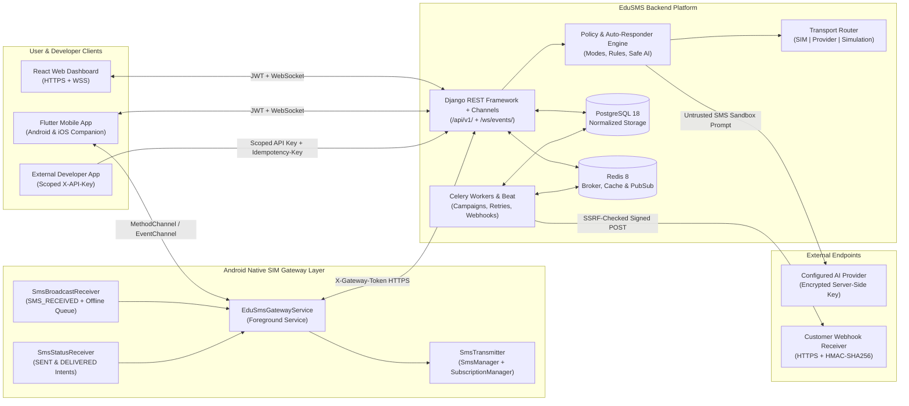
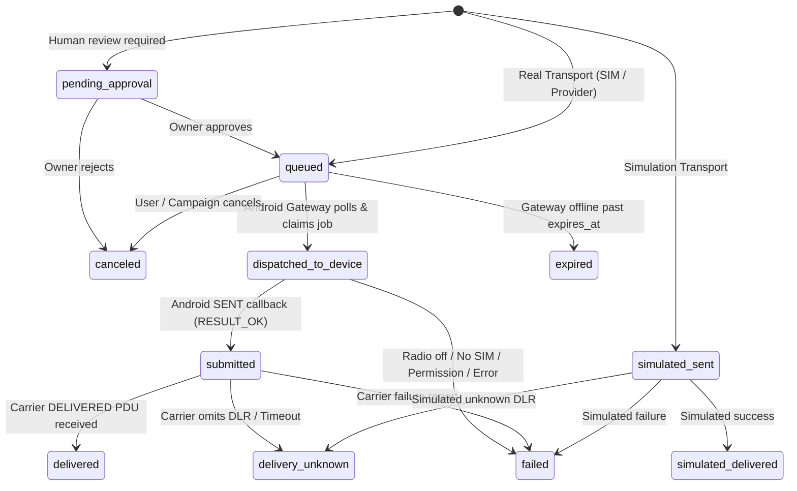

# EduSMS — System Architecture & Security Boundaries

## 1. High-Level Architecture

EduSMS separates message orchestration, policy evaluation, and account persistence on the **Django Backend** from physical radio transmission on the **Paired Android SIM Gateway**, while providing a completely isolated **Simulation Transport** for zero-cost software development and testing.

---

## 2. Strict Transport Separation & Message Lifecycle

A foundational invariant of EduSMS is **honest transport state reporting**:
1. The backend **never** claims a message was sent through a SIM when the device was offline or before Android's `SmsManager` callback reports acceptance.
2. Android `SENT` (`Activity.RESULT_OK`) maps to `submitted` ("Accepted by handset for radio transmission"), **never** `delivered`. Only a genuine `DELIVERED` carrier status report PDU transitions a real SIM message to `delivered`.
3. Failed real SMS transmissions **never** silently fall back to Simulation Mode.
4. Simulation Mode uses `transport_type = "simulation"`, `is_simulation = true`, and dedicated simulated statuses (`simulated_sent`, `simulated_delivered`, `simulated_received`) enforced by PostgreSQL `CheckConstraint`s so simulated records can never be counted or displayed as carrier-confirmed deliveries.

---

## 3. Core Data Flows

### 3.1 Outbound Real SIM Message Flow
1. User (Web/Flutter) or External API (`X-API-Key` + `Idempotency-Key`) POSTs to `/api/v1/messages/` with `transport_type="sim_gateway"`, `device_id`, optional `sim_slot`, `recipient_number`, and `body`.
2. Backend normalizes `recipient_number` (e.g. `0712345678` -> `+255712345678`), checks account ownership of `device_id`, verifies suppression/opt-out/contact `allow_outgoing` policy, and creates `Message(status="queued", expires_at=...)` + `MessageAttempt` inside an atomic transaction.
3. If the paired Android device is online, a realtime hint is sent over WebSocket/heartbeat, or the Android `EduSmsGatewayService` polls `/api/v1/devices/gateway/jobs/poll/` with `X-Gateway-Token`.
4. Backend atomically transitions eligible non-expired jobs to `dispatched_to_device` using `SELECT ... FOR UPDATE SKIP LOCKED` to guarantee zero duplicate claims.
5. Android `SmsTransmitter` resolves the requested `SubscriptionManager` `subId` (SIM slot), attaches unique `PendingIntent`s (`SENT_SMS_ACTION` and `DELIVERED_SMS_ACTION` keyed by `attempt_id`), and invokes `SmsManager.sendTextMessage` / `sendMultipartTextMessage`.
6. `SmsStatusReceiver` captures `SENT` result -> posts to `/api/v1/devices/gateway/status-callback/` -> backend updates `Message` to `submitted` (or `failed` with exact Android radio error code) and emits `sms.sent` / `sms.failed` webhook.
7. If carrier supports delivery reports, `SmsStatusReceiver` captures `DELIVERED` PDU -> posts callback -> backend updates `Message` to `delivered` and emits `sms.delivered` webhook.

### 3.2 Inbound SMS & Deterministic Auto-Responder Flow
1. Android `SmsBroadcastReceiver` receives `android.provider.Telephony.SMS_RECEIVED`, extracts sender MSISDN, concatenated body, timestamp, and `subscriptionId` (SIM slot), and computes a deterministic `client_event_id` (`sha256(device_id + sender + timestamp_ms + slot + body_hash)`).
2. If offline, the event is persisted in the device's local encrypted/private offline queue and retried with backoff when network returns.
3. `POST /api/v1/devices/gateway/inbound/` deduplicates on `(user, device, external_message_id)` so network retries never create duplicate messages or duplicate auto-replies.
4. If the inbound text matches standard opt-out keywords (`STOP`, `UNSUBSCRIBE`, `ONDOA`), EduSMS immediately records a `ConsentRecord(status="opted_out")` and `SuppressionRecord`, halting further automated/campaign sends to that number.
5. Otherwise, the **Auto-Responder Engine** evaluates policies in strict deterministic precedence:
   1. **Global & Safety Guards**: Global automation disabled? Outbound message echo? Shortcode/alphanumeric sender? Loop-prevention rate threshold exceeded? -> **No reply**.
   2. **Suppression & Opt-Out**: Number in `SuppressionRecord` or `Contact.opt_out_status == True`? -> **No reply** (cannot be overridden!).
   3. **Individual Contact Block / Cooldown / Quiet Hours**: `Contact.allow_auto_reply == False` or inside contact quiet hours or within per-contact cooldown? -> **No reply**.
   4. **Group Policy Restrictions**: Member of any group explicitly blocking auto-replies (unless explicitly overridden at contact level) or outside group policy? -> Enforced.
   5. **Active Automation Mode Evaluation**: Resolves contact-assigned mode -> group mode -> user's active scheduled/manual mode (`Meeting`, `Focus`, `Vacation`, `Sleeping`, `Custom`, `Default`) in the user's configured IANA time zone.
   6. **Keyword & Regex Rules**: Evaluates enabled, non-expired `AutoReplyRule`s ordered by `priority DESC, id ASC` matching sender/group/schedule constraints and per-rule cooldown/frequency caps.
   7. **Mode Template or Safe AI Fallback**: If mode specifies `rule_then_ai` or `ai_only` and `allow_ai_reply` is enabled on user + mode + group + contact, calls the configured `AIProviderConfig` adapter inside the untrusted-input prompt boundary; on timeout/error, uses deterministic fallback text if configured.
   8. **Human Approval Check**: If `require_human_approval` is enabled on the matched rule/mode, creates the outbound reply with `status="pending_approval"` and notifies the user instead of transmitting immediately.

---

## 4. Security Boundaries

| Boundary | Threat Mitigated | Controls Implemented |
|---|---|---|
| **Multi-Tenant Isolation** | Cross-account IDOR / data leakage | Every model carries explicit `user` (`Account`) ownership; all QuerySets filter by `request.user`; nested foreign keys (device, group, contact, provider) are validated to belong to `request.user`. |
| **Authentication & Sessions** | Stolen tokens / credential stuffing | Argon2/PBKDF2 password hashing, short-lived JWT access tokens, rotating refresh tokens with blacklist + `UserSession` revocation, login rate limiting, optional TOTP MFA. |
| **Gateway Device Credentials** | Rogue/lost Android handset | Single-use 10-minute pairing codes, dedicated per-device token (`edugw_...`) hashed with SHA-256 at rest, instant revocation (`revoked_at`) blocking all `/gateway/*` endpoints. |
| **Secrets at Rest** | DB dump exposing AI keys / webhook secrets | Application-level Fernet (AES-128-CBC + HMAC-SHA256 derived via HKDF from `FIELD_ENCRYPTION_KEY`) for AI API keys, TOTP secrets, and webhook signing secrets; API keys hashed one-way with SHA-256 and shown once. |
| **Untrusted Inbound SMS -> AI** | Prompt injection / secret exfiltration / loop storms | Inbound SMS isolated inside `<untrusted_sms_content>` tags with no tool/function calling, no DB/secret context injected, strict length cap, loop/shortcode suppression, per-sender cooldowns, and optional human-approval gate. |
| **Outbound Webhooks & Custom AI URLs** | Server-Side Request Forgery (SSRF) & Replay | Pre-flight URL & DNS resolution validator rejecting non-HTTPS (in prod), loopback, RFC1918 private IPs, link-local/cloud metadata (`169.254.169.254`), multicast, and HTTP redirects; HMAC-SHA256 `t=<ts>,v1=<sig>` headers with timestamp tolerance. |
| **Platform & Carrier Honesty** | Spoofing, covert monitoring, silent simulation fallback | Foreground service notification on Android, explicit consent before contact import, no sender ID spoofing on SIM gateways, honest iOS companion restrictions, and hard DB/UI separation between real and simulated messages. |
